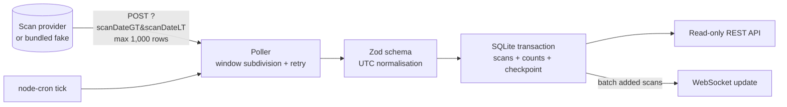

# Booth scan tracking service

A TypeScript service that imports event-booth badge scans from a scan provider, keeps deduplicated per-badge counts in SQLite, and pushes count updates to WebSocket clients. It suits a game or leaderboard that rewards attendees for visiting booths: the provider only returns raw scans, and this service turns them into a queryable, live-updating tally.

It was built as an integration prototype for an EventsCloud-style scan endpoint. The repository ships a local fake provider with seeded demo data, so everything below runs without a provider account or real attendee data.



## Run it

### With Docker Compose

```sh
docker compose up --build
```

This starts two containers from one image:

- `fake-upstream` serves 2,500 seeded scans across 40 demo badges and five booths on 4 February 2026.
- `api` polls it at startup and then every 15 seconds. It listens on `http://127.0.0.1:3000` and stores its SQLite file in the `scan-data` volume.

The first poll imports 2,416 scans; the other 84 have no booth name and are skipped. Then check the API:

```sh
curl -s http://127.0.0.1:3000/players/top
```

`docker compose down -v` stops the stack and deletes the database volume.

### With Node.js

Node 22.13 or newer is required (`.nvmrc` pins 22). `better-sqlite3` is a native module. npm downloads a prebuilt binary for common platforms and otherwise compiles it, which needs Python and a C++ toolchain.

```sh
npm ci
npm run build
cp .env.example .env
npm run fake-upstream   # terminal 1: fake provider on 127.0.0.1:4010
npm start               # terminal 2: API on 127.0.0.1:3000, reads .env
```

During development, `npm run dev` runs `index.ts` through tsx watch.

## Configuration

| Variable | Default | Purpose |
| --- | --- | --- |
| `API_URL` | required | Provider scan endpoint (http or https) |
| `API_TOKEN` | required | Sent as `{"token": ...}` in each request body |
| `EVENT_START_DATE` | `1970-01-01T00:00:00.000Z` | Where the first poll starts when no checkpoint exists |
| `POLL_INTERVAL_CRON` | `*/5 * * * *` | node-cron expression; six fields adds seconds |
| `DB_PATH` | `./data/booth-scans.db` | SQLite file; the directory is created if missing |
| `HOST` / `PORT` | `127.0.0.1` / `3000` | Listen address. The image sets `HOST=0.0.0.0` |
| `LOG_LEVEL` | `info` | pino level, or `silent` |
| `API_DEBUG_ERRORS` | unset | `true` puts 500 error messages and stacks in responses |

`.env.example` points at the fake provider with the token `demo-token`. To poll a real provider, replace both values with credentials you are authorised to use. Starting the server polls immediately.

## HTTP API

Every response uses one envelope: `{"success": bool, "data": ..., "error": null | {code, message, details}}`.

| Route | Returns |
| --- | --- |
| `GET /health` | Liveness only; it does not check the provider |
| `GET /players` | All badges with counts, highest first (ties by badge id) |
| `GET /players/top`, `/players/bottom` | One badge, or 404 `PLAYERS_EMPTY` before any import |
| `GET /players/:badgeId` | The badge's count and up to 1,000 of its scans, oldest first |
| `GET /scans` | Filtered scans, oldest first, with offset paging |

`/scans` accepts these filters:

- `badgeId`: exact match.
- `boothName`: case-insensitive substring.
- `scanDate`: UTC prefix, such as `2026-02-04` or `2026-02-04T09`.
- `limit`: 1 to 500, default 50.
- `offset`: default 0.

`%` and `_` in filters are matched literally.

The examples below were captured from the Compose stack. Long arrays are shortened with `...`.

```sh
curl -s 'http://127.0.0.1:3000/players/top'
```

```json
{"success":true,"data":{"player":{"badgeId":"demo-badge-003","scanCount":82,"lastScanDate":"2026-02-04T15:59:04.196Z"}},"error":null}
```

```sh
curl -s 'http://127.0.0.1:3000/players/demo-badge-007'
```

```json
{"success":true,"data":{"badgeId":"demo-badge-007","scanCount":64,"lastScanDate":"2026-02-04T15:49:08.982Z","scans":[{"boothName":"Hall C / Sponsor Lounge","scanDate":"2026-02-04T08:08:25.868Z"},{"boothName":"Hall B / Merch","scanDate":"2026-02-04T08:11:56.057Z"},...]},"error":null}
```

```sh
curl -s 'http://127.0.0.1:3000/scans?boothName=coffee&limit=2'
```

```json
{"success":true,"data":{"scans":[{"badgeId":"demo-badge-011","boothName":"Hall A / Coffee Bar","scanDate":"2026-02-04T08:00:09.439Z"},{"badgeId":"demo-badge-024","boothName":"Hall A / Coffee Bar","scanDate":"2026-02-04T08:00:22.253Z"}],"total":485,"limit":2,"offset":0},"error":null}
```

Errors use the same envelope:

```sh
curl -s 'http://127.0.0.1:3000/scans?limit=501'     # 422
curl -s 'http://127.0.0.1:3000/players/nobody'      # 404
```

```json
{"success":false,"data":null,"error":{"code":"VALIDATION_ERROR","message":"Validation failed","details":{"formErrors":[],"fieldErrors":{"limit":["Too big: expected number to be <=500"]}}}}
{"success":false,"data":null,"error":{"code":"PLAYER_NOT_FOUND","message":"Player not found","details":{"badgeId":"nobody"}}}
```

## WebSocket feed

Connect to `ws://127.0.0.1:3000/` (any path). The server sends a `snapshot` with every badge's count. After each imported batch that adds at least one new scan, it sends an `update` with the full list:

```json
{"type":"snapshot","players":[{"badgeId":"demo-badge-003","scanCount":82,"lastScanDate":"2026-02-04T15:59:04.196Z"},...]}
```

The fake provider can add a live scan stamped "now", which the next poll picks up:

```sh
docker compose exec api node -e 'fetch("http://fake-upstream:4010/demo/scans",{method:"POST",headers:{"content-type":"application/json"},body:JSON.stringify({token:"demo-token",badgeId:"demo-badge-041",boothName:"Hall C / Sponsor Lounge"})}).then(r=>r.text()).then(console.log)'
```

Within 15 seconds, connected clients receive the update. In the captured run it listed 41 players, including the new badge:

```json
{"type":"update","players":[{"badgeId":"demo-badge-003","scanCount":82,"lastScanDate":"2026-02-04T15:59:04.196Z"},...,{"badgeId":"demo-badge-041","scanCount":1,"lastScanDate":"2026-11-08T23:58:18.313Z"}]}
```

## How the import works

- **Window subdivision instead of cursor paging.** The provider filters with exclusive `scanDateGT` / `scanDateLT` bounds and returns at most 1,000 rows. When a window returns a full page, the poller splits the window in half and fetches each half, recursing as needed. It does not page by the last timestamp, because many scans can share one timestamp. The right half starts one millisecond early so the exact split instant is not lost. If more than 1,000 scans share a single millisecond, the cycle fails rather than claiming completeness.
- **One transaction per batch.** Each batch inserts its scans, increments counts only for rows that were actually new, and saves the batch's latest timestamp as the checkpoint. A crash mid-batch leaves the checkpoint where it was.
- **Replay and dedup.** Each cycle resumes one millisecond before the checkpoint and relies on the unique `(badge_id, scan_date)` key to ignore rows it already has. After a restart, only the rows in the checkpoint's millisecond are fetched again.
- **UTC throughout.** The provider sends timestamps without a zone (`2026-02-04T10:00:00.123`). The service reads them as UTC regardless of the host time zone and stores them as ISO strings with milliseconds, so checkpoints and filters compare correctly.
- **Booth name.** It is taken from the first `customFields` entry that has a non-empty `"Booth Name"`. Scans without one are skipped.
- **Defensive fetches.** Requests time out after 30 seconds, redirects are refused, responses over 8 MiB are rejected, and non-JSON responses fail the batch. Each request retries three times with exponential backoff. Failure logs carry only the error message, never the request body that holds the token.
- **Shutdown.** On SIGTERM the service stops the cron task and waits for a running cycle to commit. It then closes WebSocket clients with code 1001 (terminating stragglers after two seconds), and finally closes the server and database.

## Tests and checks

```sh
npm test            # Vitest: 39 tests in 10 files
npm run typecheck   # tsc over sources and tests
npm run lint        # ESLint with typescript-eslint
```

The suite uses no network beyond loopback:

- **End-to-end poll:** real HTTP to the fake provider on an ephemeral port, into in-memory SQLite. It covers subdivision, checkpointing, a no-op second cycle and a rejected token.
- **API and WebSocket:** supertest against `createApp`, plus a WebSocket snapshot and update.
- **Units:** timestamp parsing (including a non-UTC host zone), the scheduler's shutdown wait, and the repositories.

## Limits

- **No authentication.** The REST API and WebSocket feed have none, and they expose badge visit histories. The server binds to loopback by default. Put it behind an authenticated boundary, and agree on retention, before exposing it.
- **Dedup key.** Deduplication is by `(badgeId, scanDate)`, so one badge scanned at two booths in the same millisecond counts once.
- **Late arrivals.** Scans the provider back-fills earlier than the checkpoint are not picked up. The provider's real ordering and late-arrival behaviour have not been verified against a live account.
- **Full-list messages.** Each WebSocket message and `GET /players` carry every badge, which is fine for hundreds of attendees but not for very large events.
- **Single writer.** One process owns the SQLite file. Running several instances needs a different storage and locking design.

## License

MIT. See [LICENSE](LICENSE).
